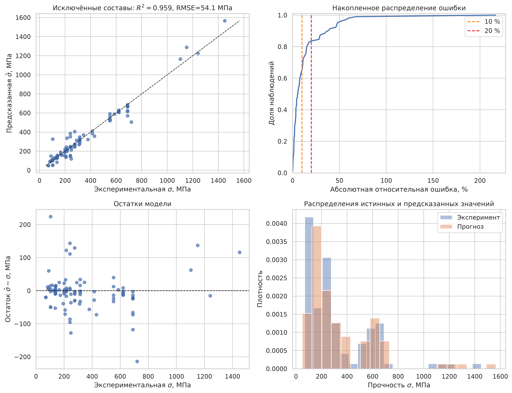
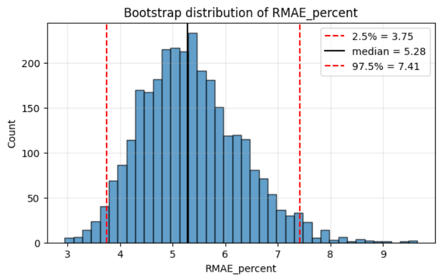

<div align="center">

# Нейросетевое моделирование никелевых суперсплавов

**Прогнозирование температуры сольвуса γ′-фазы и жаропрочности по химическому составу**

<!-- [](paper.pdf)
[](https://www.python.org/)
[](LICENSE) -->

[Читать отчёт](build/paper.pdf) · [Исходники отчёта](src/main/main.tex) · [Библиография](src/bibliography)

</div>

---

## О проекте

Исследовательская работа посвящена воспроизведению и анализу моделей для двух задач материаловедения:

- прогнозирование температуры сольвуса γ′-фазы по химическому составу сплава;
- прогнозирование предела прочности с учётом параметра Ларсона—Миллера.

Для первой задачи используется нейронная сеть с дифференциальным слоем, в которую встроена априорная информация о физической роли легирующих элементов. Для второй — байесовская регуляризованная нейронная сеть (BRANN).

## Основные результаты

| Задача | Подход | Результат |
|---|---|---:|
| Температура сольвуса | Нейронная сеть с дифференциальным слоем | RRMAE: **4,36 ± 0,79 %** |
| Температура сольвуса | Кросс-валидация | RRMSE: **0,08 ± 0,0001** |
| Предел прочности | BRANN | RRMSE: **0.2907 МПа** |

Результаты первой модели дополнительно проверены кросс-валидацией и бутстрэп-анализом неопределённости.
Качество второй моделей оценивалось с помощью групповой кросс-валидации и OOF-прогнозов проверяемые составы исключались из обучения соответствующей модели.

<div align="center">
  
  
</div>

## Ноутбуки

В репозитории сохранены основные этапы вычислительных экспериментов:

- [модель температуры сольвуса с дифференциальным слоем](Simulation%20of%20the%20nickel%20superalloys%20solvus%20temperature%20by%20the%20deep%20learning%20artificial%20neural%20network%20with%20differential%20layer.ipynb);
- [BRANN и зависимость от параметра Ларсона—Миллера](BRANN22.ipynb);
<!-- - ноутбуки `analis_data*` для разведочного анализа и подготовки данных. -->

## Структура репозитория

```text
.
├── *.ipynb                  # эксперименты и анализ данных
├── paper.tex                 # точка входа LaTeX-документа
├── paper.pdf                 # собранный отчёт
├── include/                  # настройки и стили шаблона
└── src/
    ├── bibliography/         # библиографические базы BibTeX
    ├── images/               # графики и иллюстрации
    ├── main/                 # главы и разделы отчёта
    ├── pages/                # дополнительные страницы
    ├── structure.tex         # структура документа
    └── variables.tex         # метаданные PDF
```

## Сборка отчёта

Понадобятся XeLaTeX, `latexmk` и `biber`. Подробная установка TeX-окружения описана в [INSTALL.md](INSTALL.md).

```bash
latexmk -output-directory=build -pdf -pdflatex="xelatex %O %S" paper.tex
```

Готовый документ появится в /build репозитория.

## Используемые методы

- физически информированное группирование легирующих элементов;
- дифференциальный слой для формирования нелинейных признаков;
- байесовская регуляризация нейронной сети;
- параметр Ларсона—Миллера;
- кросс-валидация и бутстрэп-оценка метрик.

## Статус

Модель температуры сольвуса воспроизведена и оценена. BRANN-модель жаропрочности воспроизведена и оценена.

## Лицензия

Исходные материалы распространяются по лицензии [MIT](LICENSE).
